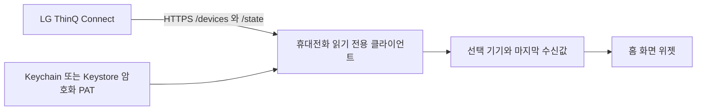

# 설계와 API 근거

## 데이터 흐름

Android 기기 목록은 응답의 `response[]` 중 `deviceInfo.deviceType`이 `DEVICE_HUMIDIFIER`, `DEVICE_AIR_PURIFIER`, `DEVICE_AIR_PURIFIER_FAN`인 항목을 표시합니다. iOS는 기존 가습기 필터를 유지합니다. 이름은 `deviceInfo.alias`, ID는 `deviceId`를 사용합니다. 상태는 `GET /devices/{id}/state` 응답의 `response.airQualitySensor`에서 현재 온도와 습도를 읽습니다. 습도 제어 리소스의 `targetHumidity`는 사용하지 않습니다. 숨은 센서값이나 읽기 권한을 얻기 위한 장치 제어 요청은 보내지 않습니다.

## 공식 SDK 확인 자료

2026-11-06 확인. 소스 코드를 복사하지 않고 공개 API 계약을 참고해 독립 구현했습니다.

- [LG ThinQ Connect API](https://thinq.developer.lge.com/en/cloud/docs/thinq-connect/api-reference/device-api/)
- [LG 공식 Python SDK HTTP 클라이언트](https://github.com/thinq-connect/pythinqconnect/blob/main/thinqconnect/thinq_api.py): 지역별 API 호스트, 공통 헤더, 메시지 ID, `/devices`와 `/state`, `response` 봉투 (검토한 blob `cf63e3875851181a176c647518cc0b96b969b376`).
- [가습기 매핑](https://github.com/thinq-connect/pythinqconnect/blob/main/thinqconnect/devices/humidifier.py): `airQualitySensor.temperature`와 `humidity` (검토한 blob `26af9bf537c77ccb0d0c86b8caab63bff25525a9`).
- [공개 클라이언트 식별 키](https://github.com/thinq-connect/pythinqconnect/blob/main/thinqconnect/const.py): SDK에 공개된 `API_KEY`는 앱 식별용 상수이며 사용자 PAT와 다릅니다. SDK와 같은 키를 사용합니다. LG 정책 변경 시 공식 SDK를 다시 확인해야 합니다.
- [지역 매핑](https://github.com/thinq-connect/pythinqconnect/blob/main/thinqconnect/country.py): 한국 `kic`, 미주 `aic`, 유럽 등 `eic`. 모든 국가의 지원을 추정하지 않고 사용자가 계정 지역을 명시합니다. LG가 해당 국가를 지원하지 않으면 API 오류를 표시합니다.

## 값과 실패 처리

실수·정수만 허용합니다. 문자열·불리언·null·비유한 수치, 온도 -50~80°C 밖, 습도 0~100% 밖은 제공되지 않는 센서로 취급합니다. 0°C와 0%는 정상값입니다. 이 경계는 UI의 오류/센티널 방어 범위이며 LG 센서의 정확도 보증이 아닙니다.

401 및 API 코드 1103/1218/1302는 재인증, 429/1306은 요청 한도, 1222는 오프라인으로 분류합니다. 그 외 실패는 연결·권한 확인을 안내합니다. 응답의 서버 메시지나 예외 원문을 사용자에게 출력하지 않아 PAT나 기기 내부 정보를 노출하지 않습니다. Android 읽기 중 1 MiB 제한을 적용합니다. Swift는 수신 후 크기를 검증합니다. 신뢰된 LG HTTPS 호스트만 사용하고 리다이렉트는 두 구현 모두 거부합니다.

기본 요청 간격은 30분, 재시도는 다음 예약 시점에 수행합니다. 앱 수동 요청은 최소 1분을 둡니다. iOS는 WidgetKit 타임라인, Android는 WorkManager와 AppWidget 업데이트를 사용합니다. iOS는 90분 경과 시점의 타임라인 항목을 미리 생성합니다. Android는 OS가 위젯 업데이트를 지연하면 오래된 데이터 문구 갱신도 지연될 수 있습니다. 그래서 마지막 수신 시각을 표시합니다.

## 범위

iOS 위젯별 다른 기기 선택, 온도 단위 변경, 알림, 센서 이력, MQTT 스트리밍, 기기 제어는 구현 범위에 포함하지 않습니다. 읽기 목적에 맞게 앱 서버, LG 계정 비밀번호, 별도 계정 시스템을 두지 않습니다. 앱 마켓 제출용 브랜딩·배포 서명·프로비저닝은 계정 소유자 설정이 필요합니다.

## Android 여러 기기와 위젯 (1.1.0)

- Gradle이 루트 `.env`를 읽어 BuildConfig를 생성합니다. 환경 변수가 파일보다 우선하며, 파일의 변경은 다음 빌드에 반영됩니다. 런타임에는 내장 설정의 SHA-256 식별자를 비교해 바뀐 인증을 Keystore에 저장합니다. 토큰 자체는 화면/로그에 출력하지 않습니다.
- `Store`는 선택 목록과 검색 목록을 구분하고, 기기 ID별 reading/error/attempt 및 위젯 ID별 순서 있는 최대 두 기기를 저장합니다. 이전 버전의 단일 기기와 센서 캐시는 첫 접근에 이전합니다. 제거된 기기의 캐시는 삭제하며 나머지는 유지합니다.
- `RefreshWorker`는 선택된 기기를 순차 갱신하고 기기별 1분 제한을 적용합니다. 하나의 기기 오류가 다른 기기 수신을 막지 않습니다. 설정 변경 시 세대를 바꿔 늦은 결과를 거부하며, 수동 갱신은 현재 작업 뒤에 연결해 변경 직후 요청이 누락되지 않게 합니다.
- `ClimateWidget`(1×1), `PairClimateWidget`(1×2), `HorizontalClimateWidget`(2×1)을 런처에 별도로 등록합니다. Android 12 이상은 RemoteViews 크기 맵으로 1대/세로 2대/가로 2대 레이아웃을 선택하며, 이전 Android는 옵션 크기로 선택합니다. 두 번째 기기 설정은 작게 줄여도 유지됩니다.
- `WidgetConfigActivity`는 자신에게 속한 실제 위젯 ID만 허용하고, 첫 번째/두 번째 기기를 개별 지정합니다. 삭제/복원 콜백은 위젯별 설정을 정리/이전합니다.

근거: [LG 공식 JS SDK 기기 속성](https://github.com/thinq-connect/jsthinqconnect), [Android 위젯 크기와 반응형 레이아웃](https://developer.android.com/develop/ui/views/appwidgets/layouts), [위젯별 설정](https://developer.android.com/develop/ui/views/appwidgets/configuration).

## Android 1.2.0 위젯 외관

`WidgetStyle`은 배경, 습도 강조색, 배경 불투명도를 보관하며 배경 밝기로 기본 글자색을 결정합니다. 6가지 프리셋과 직접 `#RRGGBB` 입력을 지원합니다. `Store`의 `style:{widgetId}`에 저장하고 위젯 삭제/복원 시 기기 선택과 함께 정리/이전합니다. 기기 선택 변경과 색상 변경은 독립적입니다.

`WidgetConfigActivity`는 편집 중 설정을 메모리에 두고 실제 RemoteViews를 미리보기로 렌더링합니다. 적용 시에만 저장합니다. 배경과 강조색의 대비가 너무 낮으면 적용 전 안내합니다. Android 12 이상은 `RemoteViews.setColorStateList`로 둥근 배경의 tint를 바꾸고, 이전 Android는 배경색으로 적용합니다. 이름/숫자/시각은 가운데 정렬하고 안쪽 여백을 둡니다. 수신 시각은 작은 너비에서도 읽히도록 HH:mm으로 표시합니다.

API 근거: [Android RemoteViews](https://developer.android.com/reference/android/widget/RemoteViews).
